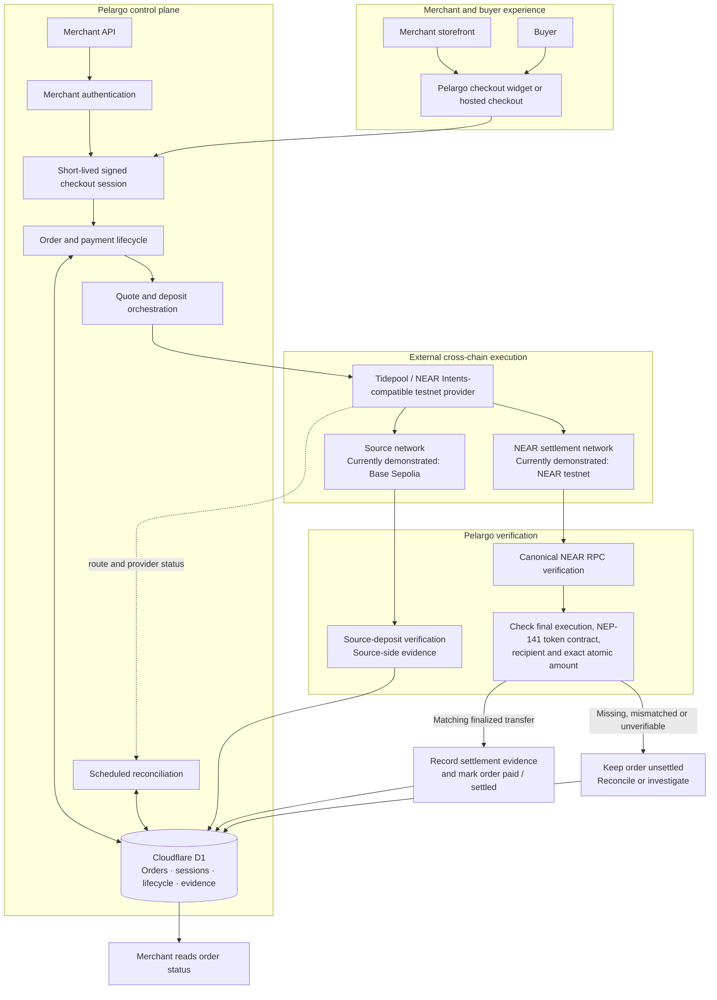

# Pelargo

**Pay across chains. Settle on NEAR.**

Pelargo is building a global, embeddable checkout for merchants. Customers pay using supported assets from supported networks; payments are routed to settle on NEAR, which serves as Pelargo's core settlement network. Merchants integrate the checkout widget into their own storefront or use hosted checkout. Pelargo manages the merchant order and checkout lifecycle, then independently verifies settlement on NEAR before marking an order paid.

The widget is the global payment interface. NEAR is the settlement home. Other networks are payment entry points, while NEAR is the network where Pelargo is designed to complete and verify merchant settlement. Supported stablecoins such as USDC are part of the asset mix, but Pelargo is not a stablecoin-only product. The long-term ambition is broad global access; current route and asset support remains limited to what has actually been implemented and verified.

## Demo and source

- **Current merged-main demo (Preview/testnet):** https://main.pelargo.pages.dev
- **Release-candidate deployment:** https://release-hackathon-candidate.pelargo.pages.dev
- **Integrated Preview (development/acceptance):** https://reliability-background-recon.pelargo.pages.dev
- **Repository:** https://github.com/BigWave45/Pelargo
- **Vision and development history:** [docs/VISION_AND_DEVELOPMENT_HISTORY.md](docs/VISION_AND_DEVELOPMENT_HISTORY.md) (product direction, parallel development branches and commit-history context)
- **Judge guide and reproducible evidence:** [docs/JUDGE_GUIDE.md](docs/JUDGE_GUIDE.md)
- **Testing and acceptance record:** [docs/TESTING.md](docs/TESTING.md)
- **Merchant integration guide:** [docs/INTEGRATION.md](docs/INTEGRATION.md)

The main and candidate URLs are non-production Preview deployments using the isolated Preview environment and Preview D1 database. They are testnet demonstrations. Do not use them to collect customer funds. The built-in production hostname, https://pelargo.pages.dev, remains on the separately configured production branch.


## Judge walkthrough: hosted testnet checkout

Use the merged-main Preview deployment: **https://main.pelargo.pages.dev**. It is an isolated testnet demonstration, not a production payment endpoint.

1. **Open the merchant workspace.** Select **Create an account**. Enter a business name, an email address you control and a password of at least 12 characters. Registration creates a merchant workspace; buyers do not need Pelargo accounts.
2. **Configure the NEAR destination.** Open **Payment destination**. For the previously verified route, enter asset ID `nep141:usdc.tidepool-sandbox.testnet`, symbol `USDC`, network `NEAR`, and decimals `6`, plus a NEAR testnet recipient. `agentg.testnet` is the recipient in the recorded end-to-end evidence. Confirm that the asset is still returned by the live Tidepool testnet catalogue before relying on it; provider availability can change. Use a public testnet receiving address only. Save the destination.
3. **Create an order.** Open **Create checkout**, enter a unique order reference and an amount, then select **Create checkout link**. Creating a link creates a short-lived signed session; it does not move funds.
4. **Open the buyer experience.** Copy the generated link and open it in a separate browser tab or private window. The buyer sees the merchant, requested amount, NEAR destination and source-asset selection. No buyer account is required.
5. **Inspect a quote preview.** Select the Base Sepolia USDC source asset `nep141:base-0x38d81431b9f76d9699af7517040d5221d9dea252.tp-omft.testnet` (6 decimals) if it remains in the live Tidepool catalogue, then request the quote preview. The dry quote displays the source amount and route details; it does not create committed deposit instructions or send funds. Do not proceed to a committed quote or transfer for a documentation-only review.
6. **Inspect the merchant lifecycle.** Return to the merchant workspace. The order should be visible as a newly created order, not as paid or settled. A checkout link or quote preview is not payment evidence. The order is marked paid only after Pelargo verifies matching NEAR destination settlement evidence.

**What this walkthrough proves:** merchant registration, destination configuration, signed checkout-session creation, the hosted buyer surface and dry-quote presentation. It does not prove a live transfer, mainnet operation, broad route coverage or production readiness. A full payment is not required to inspect these surfaces.

**Previously recorded end-to-end testnet evidence:** `ORDER-35541967` completed a Base Sepolia ERC-20 to NEAR testnet NEP-141 route. Pelargo recorded the Base Sepolia source deposit and independently verified the NEAR destination transfer: exactly 1.000000 USDC reached `agentg.testnet`. Both transaction hashes and the matching persisted Preview evidence fields are in the [judge evidence guide](docs/JUDGE_GUIDE.md); paste the hashes into the corresponding Base Sepolia and NEAR testnet explorers. This is a previously completed testnet transaction, not a new payment or a claim of mainnet operation.

**Important constraints:** the currently demonstrated route is Base Sepolia ERC-20 to NEAR testnet NEP-141 through the configured Tidepool / NEAR Intents-compatible testnet environment. The evaluator must supply a valid testnet destination asset and recipient. Provider token availability can change. Mainnet committed quotes are disabled. Do not use this Preview to collect customer funds.

If the Preview deployment is unavailable, use the local test commands below to validate the code-level checks. Those tests use mocked provider/RPC responses and do not substitute for hosted payment acceptance.

## The problem Pelargo addresses

Merchants need one checkout they can place inside an existing storefront, without having to build payment orchestration across networks or independently reconcile settlement. Pelargo is designed to let customers pay from supported networks while merchants receive settlement on NEAR. A submitted wallet transaction, source-chain deposit, or provider success response is not proof that the merchant received the expected asset. Pelargo owns the order lifecycle and verifies the expected NEAR destination transfer before an order is marked paid.

## How it works

1. A merchant creates an order and requests a short-lived, signed buyer checkout session.
2. The buyer uses the embedded Pelargo checkout widget or its hosted-checkout equivalent and connects a supported wallet.
3. Pelargo obtains a quote and deposit instructions from its configured provider.
4. The buyer submits the source-chain payment.
5. Pelargo verifies the expected destination-chain transfer and persists matching settlement evidence.
6. The order is marked paid only after destination verification succeeds.

The provider supplies route discovery, quotes, deposit instructions and provider-side transfer status. Pelargo owns merchant/order binding, checkout sessions, payment lifecycle and destination settlement verification. Provider SUCCESS alone is insufficient to mark an order paid.

### Settlement verification is an enforced boundary

A provider's SUCCESS response is treated as a candidate signal, not settlement proof. Pelargo independently checks the candidate NEAR transaction for final execution and the expected NEP-141 token contract, recipient and exact atomic amount. If the transfer is missing, mismatched or temporarily unverifiable, the order remains unsettled and no settlement evidence is written. The API integration suite includes a provider-SUCCESS case where the finalized NEAR transaction transfers the wrong amount; Pelargo keeps the lifecycle in processing, records no settlement evidence and the database rejects an evidence insert that does not match the verified candidate. It also tests an unavailable verifier and an atomic ledger-write rollback. See [the detailed test record](docs/TESTING.md#provider-success-is-not-settlement-proof).

## Demonstrated route and limitations

The current Preview demonstration uses a provider-supported **Base Sepolia ERC-20 source asset to NEAR testnet NEP-141 destination asset** route through the Tidepool / NEAR Intents-compatible testnet environment. The demonstrated destination is 1 USDC to `agentg.testnet`.

This is a specific testnet route, not universal cross-chain coverage. Route and asset availability depend on the provider's catalogue and liquidity. Pelargo does not currently provide arbitrary-chain settlement verification, automatic provider failover or route comparison. Mainnet committed quotes remain disabled.

## Why NEAR is Pelargo's settlement home

NEAR is not a placeholder destination or one interchangeable network in a list. Pelargo is being built around NEAR as its core settlement network. The intended model is that customers can pay from supported source networks and assets, while merchant settlement is completed and verified on NEAR. This gives merchants one checkout surface and gives the NEAR ecosystem a concrete payments use case: cross-network payment activity can arrive as settlement activity on NEAR, using NEAR accounts and supported NEP-141 assets.

NEAR is therefore central to both the product architecture and its ecosystem thesis. Pelargo aims to bring merchant payment flows, asset movement and real checkout demand into the NEAR economy. That is an intended contribution, not a claim that Pelargo automatically funds NEAR, its treasury, or every application in the ecosystem. The actual economic benefit depends on merchants, users, assets, liquidity and settlement volume adopting the product.

The current demonstrated route brings a payment from Base Sepolia to a NEAR testnet NEP-141 asset. Pelargo checks the destination transfer against the merchant order's expected token, recipient and amount using NEAR chain data before treating settlement as complete. The configured route uses a Tidepool / NEAR Intents-compatible testnet environment. We do not claim to implement the NEAR Intents protocol itself.

The global checkout is the product direction; current route coverage is narrower. At present, the demonstrated path is specific and testnet-only. Additional source networks, assets and NEAR settlement assets must be implemented and verified before being advertised as supported.

## Wallet connection

- External mobile browsers use the official `@metamask/connect-evm` client to initiate MetaMask app handoff and obtain an EIP-1193 provider.
- Inside MetaMask Mobile, the injected-provider path remains available.
- Reown AppKit remains available for other supported wallet sessions.
- The external iPhone browser to MetaMask handoff and a subsequent Preview checkout were manually tested by the user. The checkout completed and the merchant dashboard displayed Settled.

This is a manual acceptance result, not exhaustive compatibility testing across all mobile browsers, wallet versions or account/network-change scenarios.

## Verified Preview evidence

- **ORDER-35541967:** complete Base Sepolia-to-NEAR testnet payment evidence. Preview D1 records source transaction `0x886ff617f13d6eddb23d376eaf2437a90082b610f8c006de743b5df1a5464d5c` and matching canonical NEAR destination evidence transaction `9myMAuSbY4NAcCWDkhZUWqQLGTW47Z2dkrxjhGgtJspS`, delivering exactly 1 USDC to `agentg.testnet`. Full amounts, token identifiers and verification metadata are in [docs/JUDGE_GUIDE.md](docs/JUDGE_GUIDE.md).
- **ORDER-68886375:** user-confirmed external iPhone browser to MetaMask handoff and successful Preview checkout. Preview records order `paid`, lifecycle `settled`, provider status `SUCCESS`, and independently verified destination evidence for 1 USDC to `agentg.testnet`. No matching source-deposit evidence row is recorded for this order, so it is not described as complete dual-chain evidence.
- **External merchant acceptance:** the hosted Preview workflow passed seven checks for merchant API authentication, buyer-session validation, merchant-scoped order retrieval, duplicate-order rejection, the pre-quote payment boundary and cross-merchant isolation. It creates a pending Preview order only; it does not initiate a payment.

These testnet results do not establish mainnet or production readiness. A single observed duration is not a latency benchmark or guarantee. No additional payment is needed merely to repeat the demonstrated route.

## Merchant integration and checkout widget

The checkout widget is Pelargo's primary customer-facing product surface. A merchant authenticates server-side, creates an order and short-lived checkout session, then places the Pelargo custom element in its storefront or sends the buyer to the hosted-checkout equivalent. The widget presents the payment experience; Pelargo's API and lifecycle services bind that session to the merchant's order and verify settlement. Merchant API keys must remain on the merchant server.

The repository includes a custom-element embed and integration documentation. This is an implemented integration pattern, not yet a stable published SDK/CDN package. Pelargo does not currently provide Shopify or WooCommerce plugins or merchant webhook delivery. Supported assets and networks are limited to implemented and provider-available routes; stablecoins such as USDC are supported where a route exists, but stablecoins are not the only intended asset class. See [docs/INTEGRATION.md](docs/INTEGRATION.md) and [docs/EXTERNAL_MERCHANT_TEST.md](docs/EXTERNAL_MERCHANT_TEST.md).

## Architecture

The diagram separates Pelargo's merchant-control plane from the external execution provider and from the independent settlement-verification boundary. The provider can report route progress, but its status does not authorize Pelargo to mark an order paid.



### Component responsibilities

- **Merchant interface:** the merchant creates an order and signed checkout session; the buyer pays through the embedded widget or hosted checkout.
- **Pelargo control plane:** owns merchant authentication, order/session binding, lifecycle transitions, persistence and reconciliation.
- **Execution provider:** supplies route discovery, quotes, deposit instructions and provider-side status. It is an execution dependency, not the authority for the merchant's final paid state.
- **Source verification:** records source-side deposit evidence for supported routes. It is distinct from destination settlement verification and should not be read as a universal prerequisite for every currently implemented settlement path.
- **NEAR settlement verification:** independently checks finalized NEAR execution and the expected NEP-141 token contract, recipient and exact atomic amount. A matching destination transfer is the decisive settlement condition.
- **Persistence and recovery:** Cloudflare D1 stores order lifecycle and evidence; scheduled reconciliation revisits recoverable or incomplete states.

The currently demonstrated route is Base Sepolia ERC-20 to NEAR testnet NEP-141 through the configured Tidepool / NEAR Intents-compatible testnet environment. The diagram describes the system boundaries, not a claim of arbitrary-chain support or mainnet readiness.

- Frontend: React, TypeScript and Vite.
- Application/API: Cloudflare Pages Functions.
- Persistence: Cloudflare D1.
- Cross-chain routing: configured Tidepool / NEAR Intents-compatible testnet environment.
- Core settlement network: NEAR, with NEP-141 destination-asset settlement verification using NEAR chain data.
- Background processing: scheduled reconciliation Worker for payment lifecycle recovery and verification.

The implementation includes merchant-scoped API access, signed short-lived checkout sessions, lifecycle transition validation, audit events, provider quote binding, source-deposit verification for the configured Base Sepolia route, destination settlement verification and reconciliation-job concurrency controls.

## Testing

Deterministic local checks:

```bash
bun install --frozen-lockfile
bun run lint
bun run test:security
bun run test:api
bun run build
```

`bun run test:external-merchant` is a separate hosted smoke test. It requires merchant API keys in environment variables and creates a pending order in the integrated Preview; it does not commit a quote or initiate a payment. Do not run it as an ordinary local unit test. CI syntax-checks this script; the separately recorded hosted acceptance run passed seven checks. Automated API tests use mocked provider/RPC responses and an in-memory database. See [docs/TESTING.md](docs/TESTING.md) and the [judge guide](docs/JUDGE_GUIDE.md) for the distinction between automated tests, hosted acceptance and the completed testnet payment.

## Branch and release status

- GitHub default branch: `main`.
- Immediately before this audit, the latest merged documentation update was PR #15, merge commit `7a68207f73b4a6a0c8ef6bed678aec8dafe4a4d2`.
- PRs #8–#13 aligned integration, product positioning, judge walkthrough, settlement-proof explanation and architecture documentation.
- PR #14 removed unused Gemini capability metadata and an unused SDK dependency; it did not remove application functionality.
- PR #15 refreshed the release record through PR #13 and surfaced the completed testnet payment evidence.
- PR #16 adds this judge-readiness guide and consistency corrections.
- Integrated non-production branch: `reliability/background-reconciliation`.
- Cloudflare Pages production branch: `build/live-intents` (unchanged).
- Cloudflare Pages main-branch Preview alias: `https://main.pelargo.pages.dev`.
- Cloudflare Pages project: `pelargo`.

At the audit baseline, before PR #16, Cloudflare Pages had successfully deployed merged `main` commit `aafe4575f17ec45be7ba1deac94b6f3372ac484a` as Preview deployment `e42e77f5-d371-4b86-84f6-e0df473a2b1f`, with `https://main.pelargo.pages.dev` as its alias. The deployment stage reported success on 7 November 2026. This is a Preview deployment using isolated Preview configuration and Preview D1. Check the latest Pages deployment after PR #16 merges; a GitHub merge does not change the Cloudflare production branch or production database.

The main-branch Preview is the current hackathon demo URL. The built-in production hostname `pelargo.pages.dev` remains attached to `build/live-intents`; no production promotion or production database change is part of this release. Later documentation-only cleanup may produce additional Preview builds without changing the production branch or database.

## Safety

- All demonstrated payment activity is testnet activity.
- Keep `ALLOW_MAINNET_DEPOSITS` unset.
- Do not use Preview to collect real customer funds.
- Never expose merchant API keys, provisioning secrets, session-signing secrets or indexer credentials in browser code or public repositories.
- A quote, deposit address, provider status or wallet transaction hash is not settlement proof.
- Production branch changes, domain routing, mainnet activation and production database changes require explicit approval.

## License

MIT
