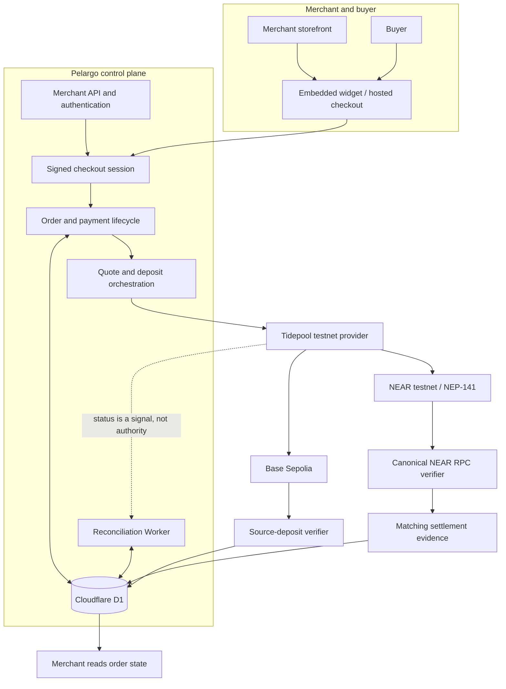

# Pelargo architecture

**Product boundary:** Pelargo owns the merchant checkout and payment lifecycle. The configured execution provider supplies route discovery, quotes, deposit instructions and provider-side status. Pelargo independently verifies the destination transfer on NEAR before recording settlement and marking an order paid.

**Current demonstrated environment:** Base Sepolia ERC-20 source asset → NEAR testnet NEP-141 destination asset, through the configured Tidepool / NEAR Intents-compatible testnet environment. This is not a claim that Pelargo implements the NEAR Intents protocol or supports arbitrary source/destination networks.

## System flow

Merchant storefront / hosted checkout
→ Pelargo merchant API and authentication
→ short-lived signed buyer checkout session
→ order and payment lifecycle in Cloudflare D1
→ provider quote and deposit orchestration
→ Tidepool testnet execution route
→ source-chain deposit observation and NEAR destination transfer
→ independent verification against canonical NEAR RPC
→ persisted settlement evidence and atomic paid/settled lifecycle update
→ merchant reads order state.

Provider status feeds reconciliation as an external signal. It is not the authority for the paid state.

## Responsibilities and trust boundaries

| Component | Responsibility | What it does not establish |
|---|---|---|
| Merchant API and authentication | Authenticates merchant requests and scopes order access to the merchant | A valid API key does not prove a buyer payment |
| Checkout session | Binds a short-lived buyer session to a merchant order | Session creation does not move funds |
| Checkout widget / hosted checkout | Presents source-asset selection, quote preview, buyer confirmation and supported wallet/deposit flow | A connected wallet, quote preview or submitted transaction is not settlement |
| Execution provider | Supplies route discovery, quotes, deposit instructions and provider-side status | Provider SUCCESS alone cannot authorize the paid state |
| Base Sepolia source verifier | Checks the configured source token, deposit destination and amount for the demonstrated EVM source route | Source evidence is not proof that the merchant received the expected NEAR asset |
| NEAR settlement verifier | Checks canonical NEAR execution and the expected NEP-141 token contract, recipient and exact atomic amount | A transaction hash alone is not proof; the transfer must match the order |
| Cloudflare D1 | Persists orders, lifecycle state and evidence under database constraints | Persistence is not a substitute for verifying chain facts before insertion |
| Reconciliation Worker | Revisits eligible or uncertain records using persisted state and guarded worker access | A deployed Cron schedule or queued job is not evidence that a scheduled run completed successfully |

## Settlement decision

1. Pelargo binds the buyer session and provider quote to the merchant order.
2. The provider reports route progress and may supply a candidate destination transaction.
3. Pelargo checks the candidate against canonical NEAR chain data.
4. Verification requires successful final execution and a matching NEP-141 transfer for the configured token contract, recipient and exact expected atomic amount.
5. Matching evidence and the paid/settled lifecycle transition are persisted atomically.
6. Missing, mismatched or unverifiable evidence leaves the order unsettled for retry or investigation.

The implementation also verifies source-deposit evidence for the configured Base Sepolia ERC-20 route. Source and destination amounts may differ because a route can convert assets and deduct fees; the destination obligation is the merchant-configured amount.

## NEAR integration

NEAR is Pelargo's settlement home. The current implementation uses NEAR testnet NEP-141 assets and canonical NEAR RPC verification. It does not currently depend on a Pelargo-owned NEAR settlement contract. Do not infer a smart-contract receipt, contract-enforced cross-chain verification, or an on-chain Pelargo treasury from this architecture.

Tidepool is the current testnet execution adapter and is NEAR Intents-compatible. The official 1Click adapter is separate and is not the current testnet execution path. Mainnet committed quotes remain disabled.

## Implementation map

| Concern | Repository location |
|---|---|
| NEAR destination settlement verification | functions/_lib/near-settlement-verifier.ts |
| Merchant integration and API contract | [INTEGRATION.md](INTEGRATION.md) |
| Payment lifecycle and adversarial verification tests | [TESTING.md](TESTING.md) |
| Scope, active branch and operational boundaries | [../SCOPE.md](../SCOPE.md) |
| Reproducible judge walkthrough and recorded payment evidence | [JUDGE_GUIDE.md](JUDGE_GUIDE.md) |

This document describes the current repository and recorded testnet evidence. It is not a production deployment diagram or a guarantee of route availability.
